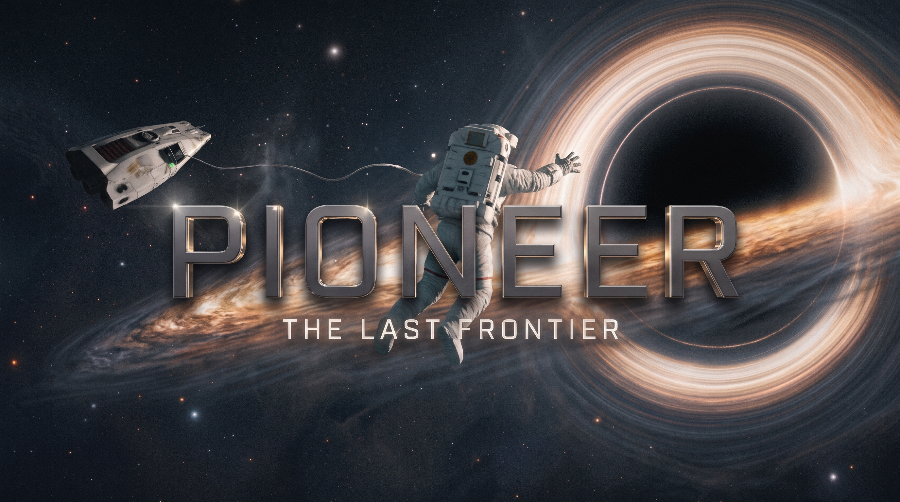

# Pioneer – The Last Frontier

**The Last Frontier** is a modified fork of [Pioneer Space Simulator](https://github.com/pioneerspacesim/pioneer).

> **Status:** work in progress, and a fun project to test LLM capabilities.
> It is 100% vibe coded: all code was written with AI assistance.
> Expect bugs, and expect modules and settings to change.
>
> This fork is not affiliated with or endorsed by the Pioneer developers.
> Please don't report bugs from this fork to the upstream Pioneer project.

## What it adds

- **Orbit Planner** – chains of planned burns, rendezvous and flyby planning,
  closed-loop autoburn, a burn HUD and a 3D orbit map with patched trajectories.
- **Surface Exploration** – leave the ship on foot or on EVA with a jetpack,
  and drive a rover carried by ships with a vehicle bay.
- **Hangars and Storage** – lease hangars at stations to store ships and swap
  your active ship, keep equipment and cargo in each hangar's store, and have
  ships, equipment and crew delivered between stations. A Fleet tab shows
  everything you own.
- **Crew Lounges** – a crew lounge at every station. Crew who aren't aboard wait
  there on half wages, can be hired straight into the lounge, and can be sent to
  a lounge at another station.
- **Hyperspace** – a relativistic jump effect and new jump sounds.
- **Weather and Clouds** – volumetric multi-layer clouds, cyclones and weather
  fronts, and cloud shadows.
- **Planet Terrain** – per-pixel ground and water, photo-based ground materials,
  river valleys and detailed terrain from orbit to the ground.
- **Cities** – layouts shaped by their planet, forcefield domes and gardens.
- **Lighting and Shadows** – sun shadows, city lights, ship lights and animated stars.
- **Audio** – wind, rover and hyperspace sounds.
- **Developer Tools** – travel tab, GPU timers and terrain debugging.

## Bugs

Bugs in The Last Frontier should be reported as issues on this repository,
not on the upstream Pioneer project.

## Getting The Last Frontier

There are no prebuilt releases yet. Build from source on the
`the-last-frontier` branch; see [COMPILING.txt](COMPILING.txt).

## License

Like Pioneer, this fork is licensed under the GNU GPL version 3. See
[licenses/GPL-3.txt](licenses/GPL-3.txt). Assets keep their original licenses;
see the [licenses](licenses) folder and [AUTHORS.txt](AUTHORS.txt).

The original Pioneer code and assets are by the Pioneer developers. The changes
in this fork are by the fork's author and are recorded in the git history.

---

# About Pioneer Space Simulator

Pioneer is a space adventure game set in the Milky Way galaxy at the turn of
the 31st century.

The game is open-ended, and you are free to explore the millions of star
systems in the game. You can land on planets, slingshot past gas giants, and
burn yourself to a crisp flying between binary star systems. You can try your
hand at piracy, make your fortune trading between systems, or do missions for
the various factions fighting for power, freedom or self-determination.

For more information, see:
  http://pioneerspacesim.net/
