

# Pioneer – The Last Frontier

**The Last Frontier** is a modified fork of [Pioneer Space Simulator](https://github.com/pioneerspacesim/pioneer).

> **Status:** work in progress, and a fun project to test LLM capabilities.
> It is 100% vibe coded: all code was written with AI assistance.
> Expect bugs, and expect modules and settings to change.
>
> This fork is not affiliated with or endorsed by the Pioneer developers.
> Please don't report bugs from this fork to the upstream Pioneer project.

## What it adds

Click a screenshot to see it larger.

### Orbit Planner

Chains of planned burns, rendezvous and flyby planning, closed-loop autoburn,
a burn HUD and a 3D orbit map with patched trajectories.

  <a href=".github/images/screens/orbit-planner-1.jpg">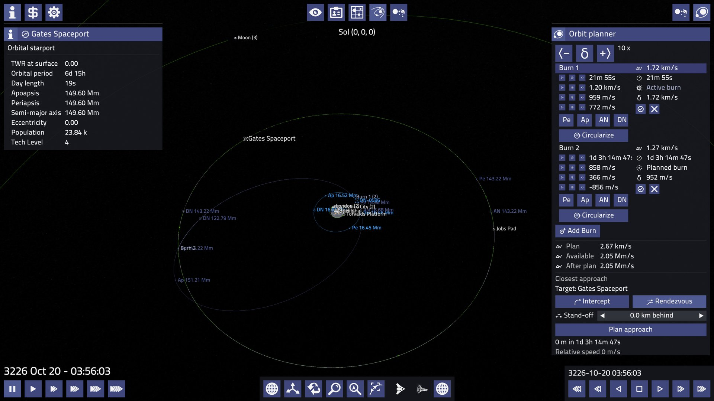</a>
  <a href=".github/images/screens/orbit-planner-2.jpg">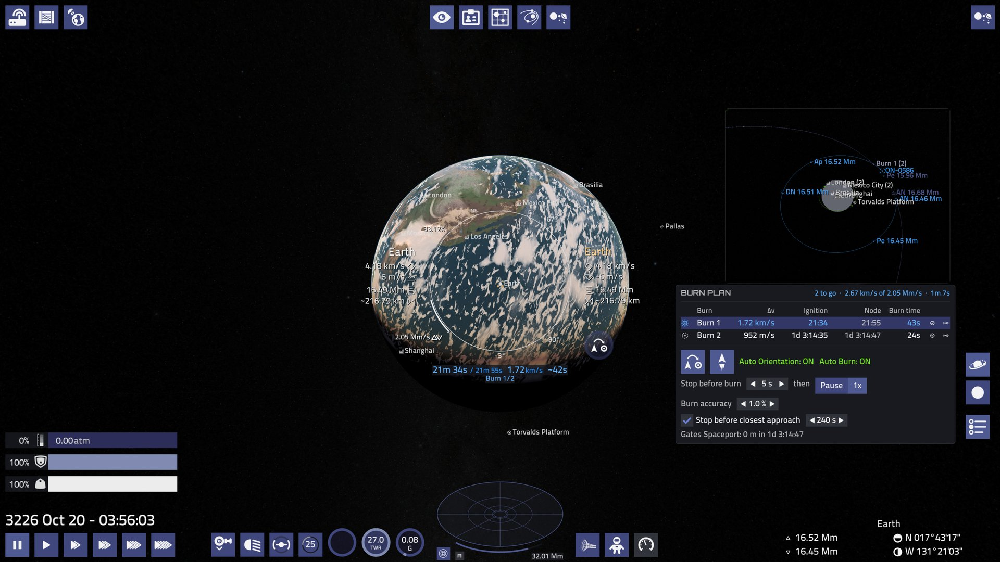</a>

### Surface Exploration

Leave the ship on foot or on EVA with a jetpack, and drive a rover carried by
ships with a vehicle bay.

  <a href=".github/images/screens/eva.jpg">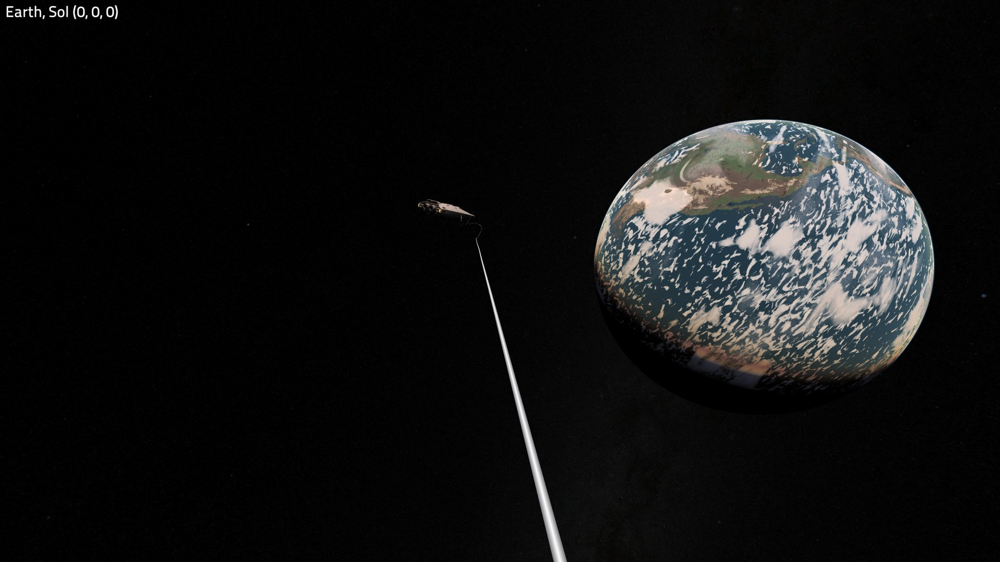</a>
  <a href=".github/images/screens/eva-rover.jpg">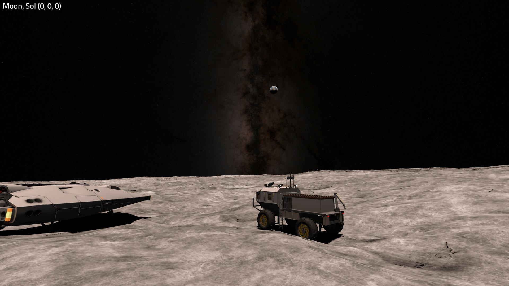</a>

### Hangars, Storage and Crew Lounges

Lease hangars at stations to store ships and swap your active ship, keep
equipment and cargo in each hangar's store, and have ships, equipment and crew
delivered between stations. Every station has a crew lounge, where crew who
aren't aboard wait on half wages; hire them straight into the lounge or send
them to another station's lounge. A Fleet tab shows everything you own.

<a href=".github/images/screens/hangar.jpg">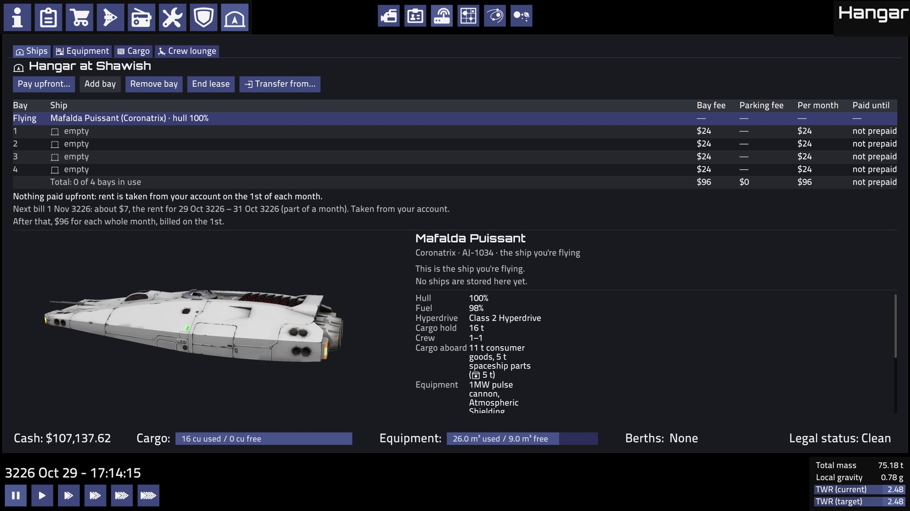</a>

### Weather and Clouds

Volumetric multi-layer clouds, weather fronts and cloud shadows.

  <a href=".github/images/screens/clouds-1.jpg">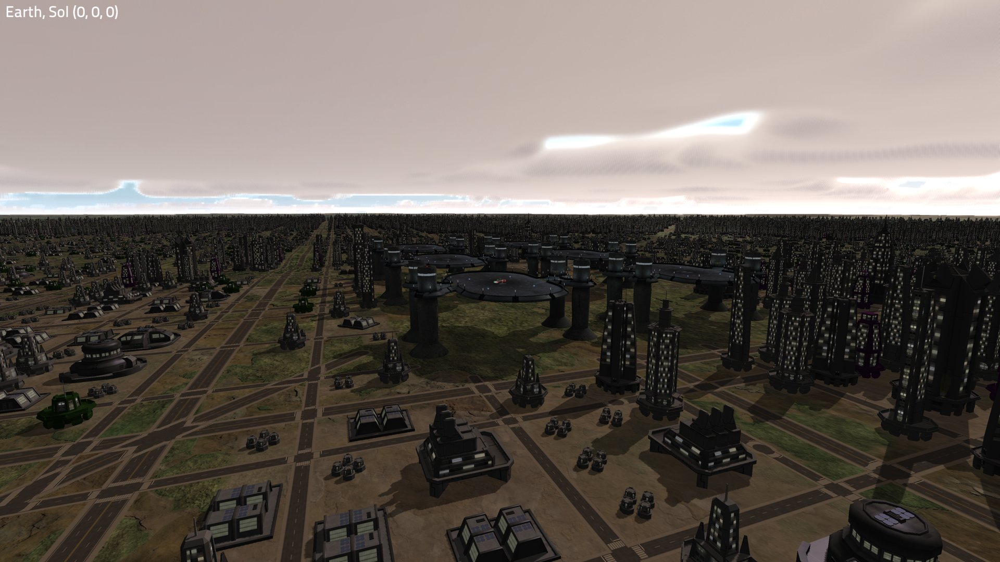</a>
  <a href=".github/images/screens/clouds-2.jpg">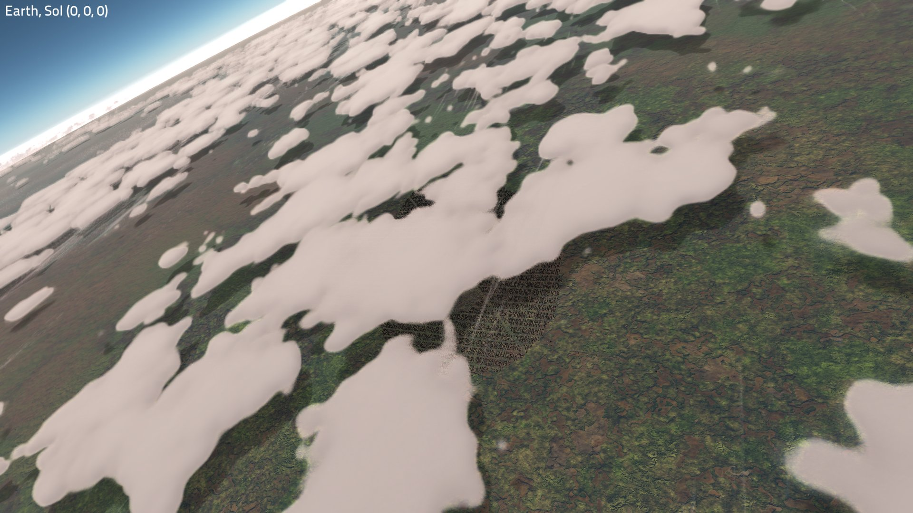</a>

### Planet Terrain

Per-pixel ground and water, photo-based ground materials, river valleys and
detailed terrain from orbit to the ground.

  <a href=".github/images/screens/terrain.jpg">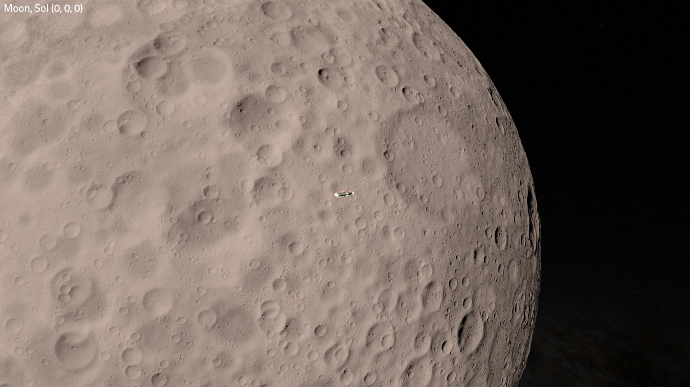</a>
  <a href=".github/images/screens/terrain-clouds.jpg">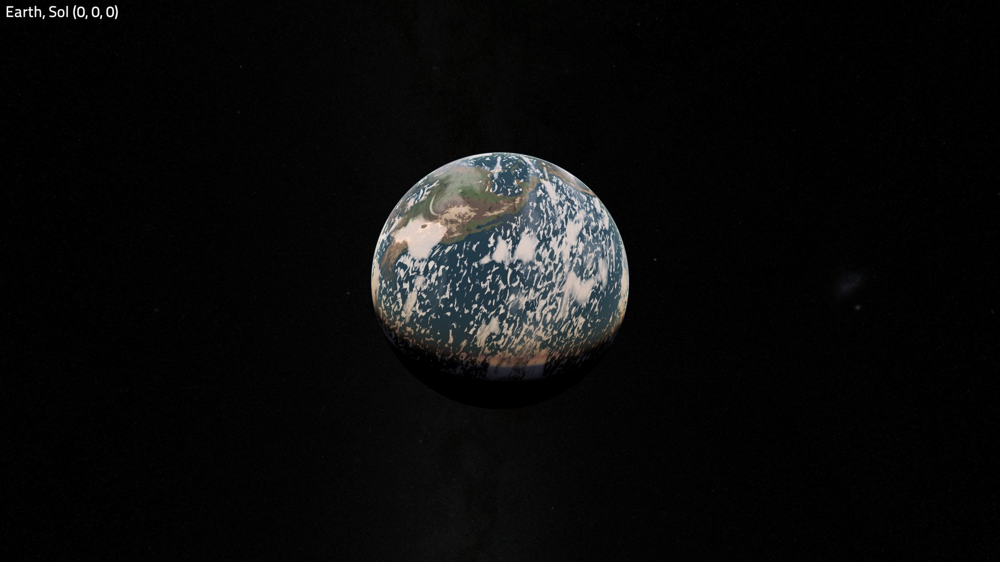</a>

### Cities

Layouts shaped by their planet, forcefield domes and gardens.

  <a href=".github/images/screens/cities-1.jpg">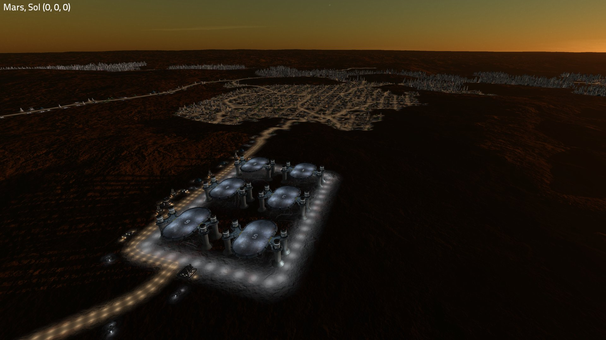</a>
  <a href=".github/images/screens/cities-2.jpg">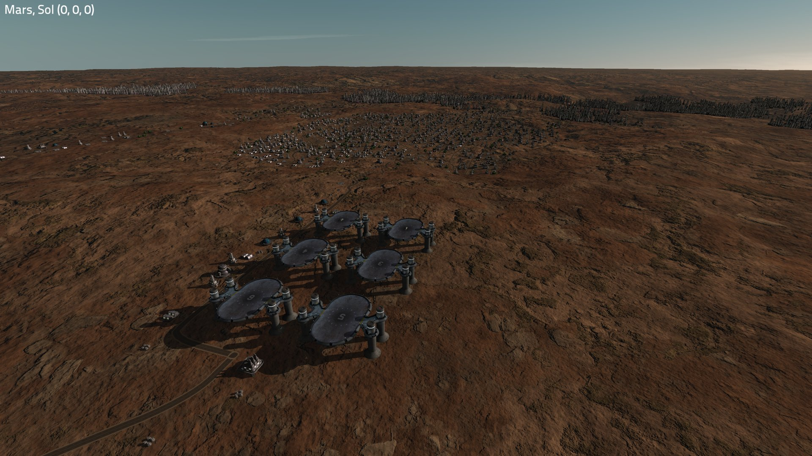</a>

  <a href=".github/images/screens/greenhouse-domes.jpg">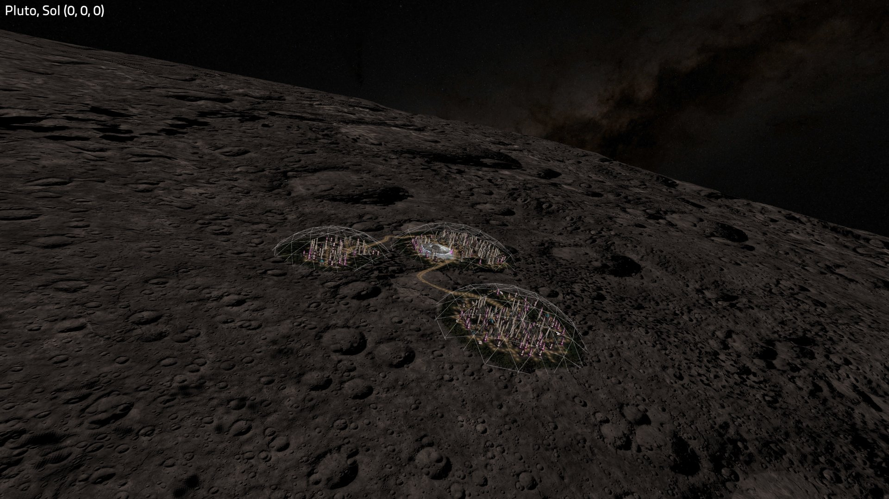</a>
  <a href=".github/images/screens/clouds-cities.jpg">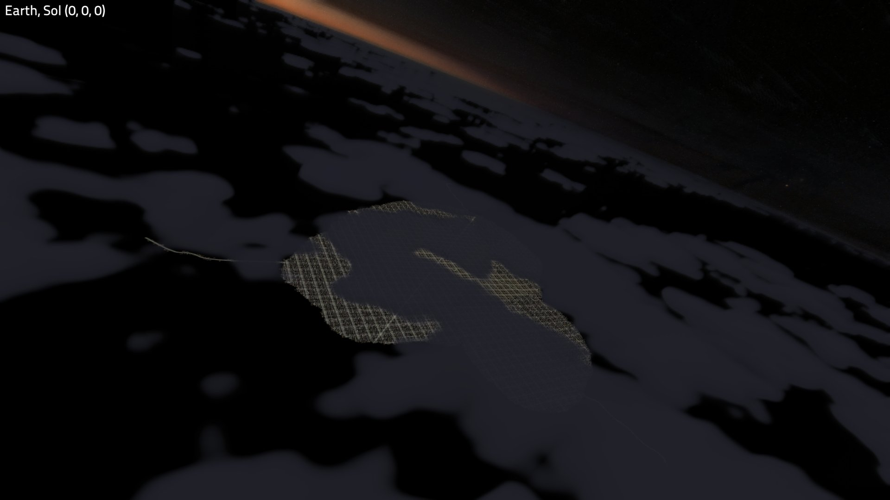</a>

### Lighting and Shadows

Sun shadows, city lights, ship lights and animated stars.

<a href=".github/images/screens/sun.jpg">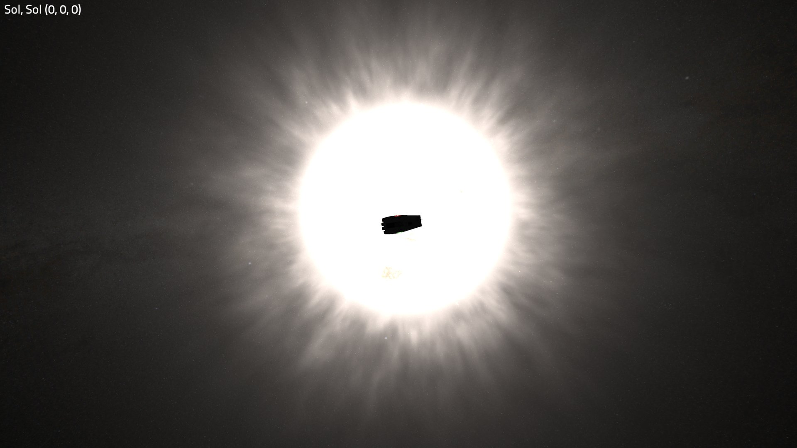</a>

### And more

- **Hyperspace** – a relativistic jump effect and new jump sounds.
- **Audio** – wind, rover and hyperspace sounds.
- **Developer Tools** – travel tab, GPU timers and terrain debugging.

## Bugs

Bugs in The Last Frontier should be reported as issues on this repository,
not on the upstream Pioneer project.

## Getting The Last Frontier

There are no prebuilt releases yet. Build from source on the
`the-last-frontier` branch; see [COMPILING.txt](COMPILING.txt).

## License

Like Pioneer, this fork is licensed under the GNU GPL version 3. See
[licenses/GPL-3.txt](licenses/GPL-3.txt). Assets keep their original licenses;
see the [licenses](licenses) folder and [AUTHORS.txt](AUTHORS.txt).

The original Pioneer code and assets are by the Pioneer developers. The changes
in this fork are by the fork's author and are recorded in the git history.

---

# About Pioneer Space Simulator

Pioneer is a space adventure game set in the Milky Way galaxy at the turn of
the 31st century.

The game is open-ended, and you are free to explore the millions of star
systems in the game. You can land on planets, slingshot past gas giants, and
burn yourself to a crisp flying between binary star systems. You can try your
hand at piracy, make your fortune trading between systems, or do missions for
the various factions fighting for power, freedom or self-determination.

For more information, see:
  http://pioneerspacesim.net/
